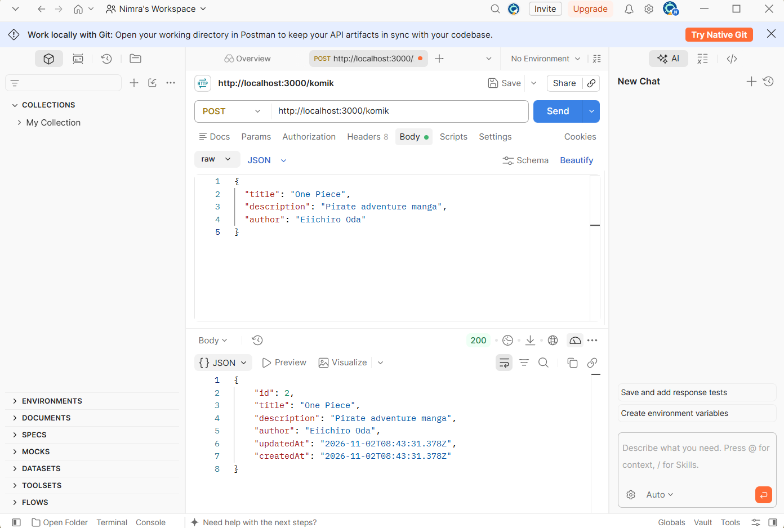
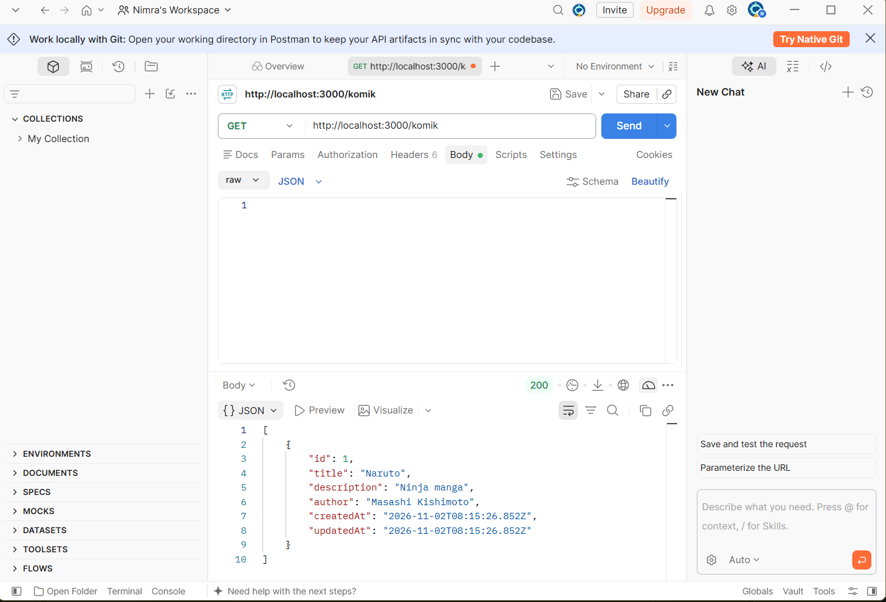
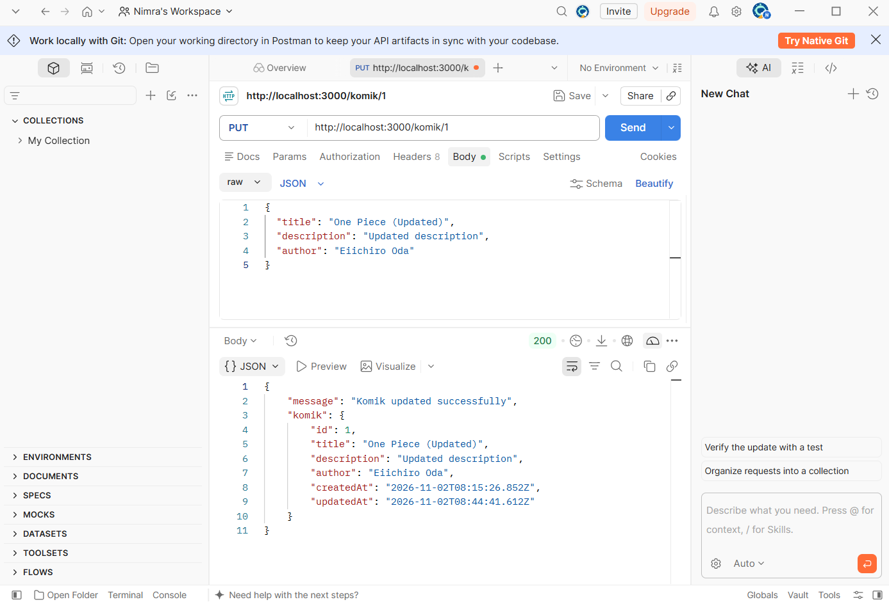
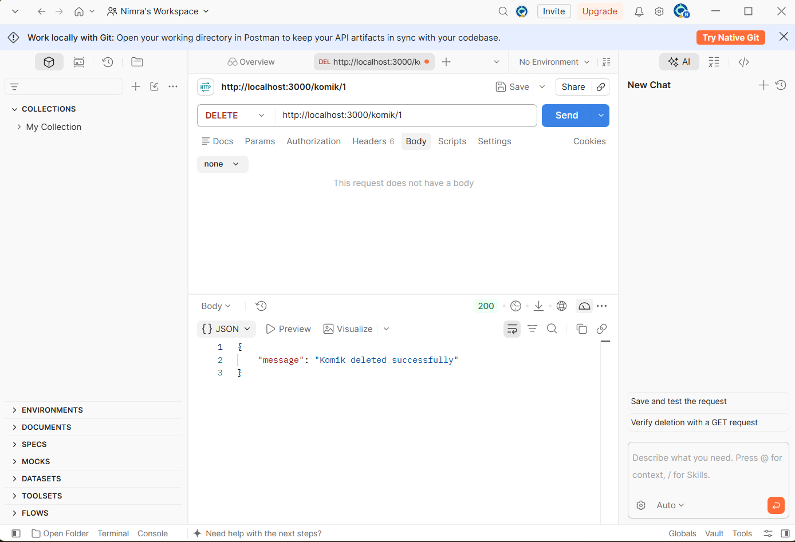

# 146_EnvORM

A simple RESTful API for managing comics (*Komik*) built with **Express.js**, **Sequelize ORM**, **PostgreSQL**, and **dotenv**.

---

## 📌 Features

- **CRUD Operations**: Full support for Create, Read, Update, and Delete operations for comic data.
- **ORM Integration**: Uses **Sequelize** with PostgreSQL for database modeling and automatic synchronization (`sync`).
- **Environment Configurations**: Sensitive credentials and database configs managed via `.env`.

---

## ⚙️ Environment Variables

Create a `.env` file in the root directory with the following variables:

```env
DB_USER=postgres
DB_PASSWORD=your_password
DB_DATABASE=Perpustakaan
DB_PORT=5432
DB_HOST=127.0.0.1
DB_DIALECT=postgres
```

---

## 🚀 Getting Started

### 1. Install Dependencies
```bash
npm install
```

### 2. Create the Database
```bash
npx sequelize-cli db:create
```

### 3. Start the Server
```bash
npm start
```
The server will run on `http://localhost:3000`.

---

## 📡 API Endpoints

| Method | Endpoint | Description | Request Body |
| :--- | :--- | :--- | :--- |
| **POST** | `/komik` | Create a new comic record | JSON `{ title, description, author }` |
| **GET** | `/komik` | Retrieve all comics | None |
| **PUT** | `/komik/:id` | Update comic details by ID | JSON `{ title, description, author }` |
| **DELETE** | `/komik/:id` | Delete a comic record by ID | None |

---

## 📸 API Testing Screenshots

### 1. POST Request (`/komik`)
Create a new comic record.



---

### 2. GET Request (`/komik`)
Retrieve the list of all comics.



---

### 3. PUT Request (`/komik/:id`)
Update comic data by ID.



---

### 4. DELETE Request (`/komik/:id`)
Delete a comic by ID.


